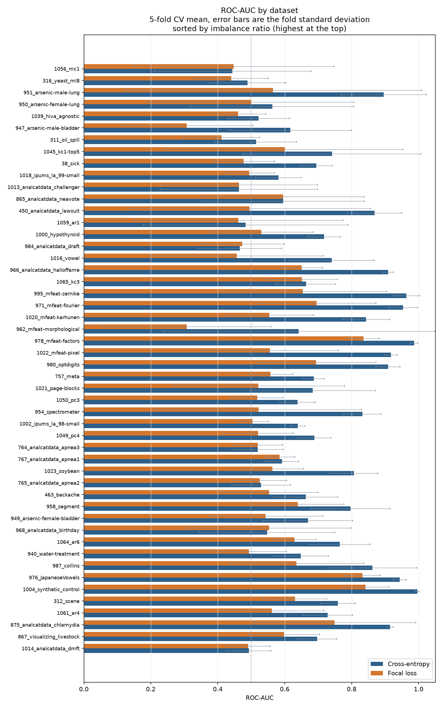
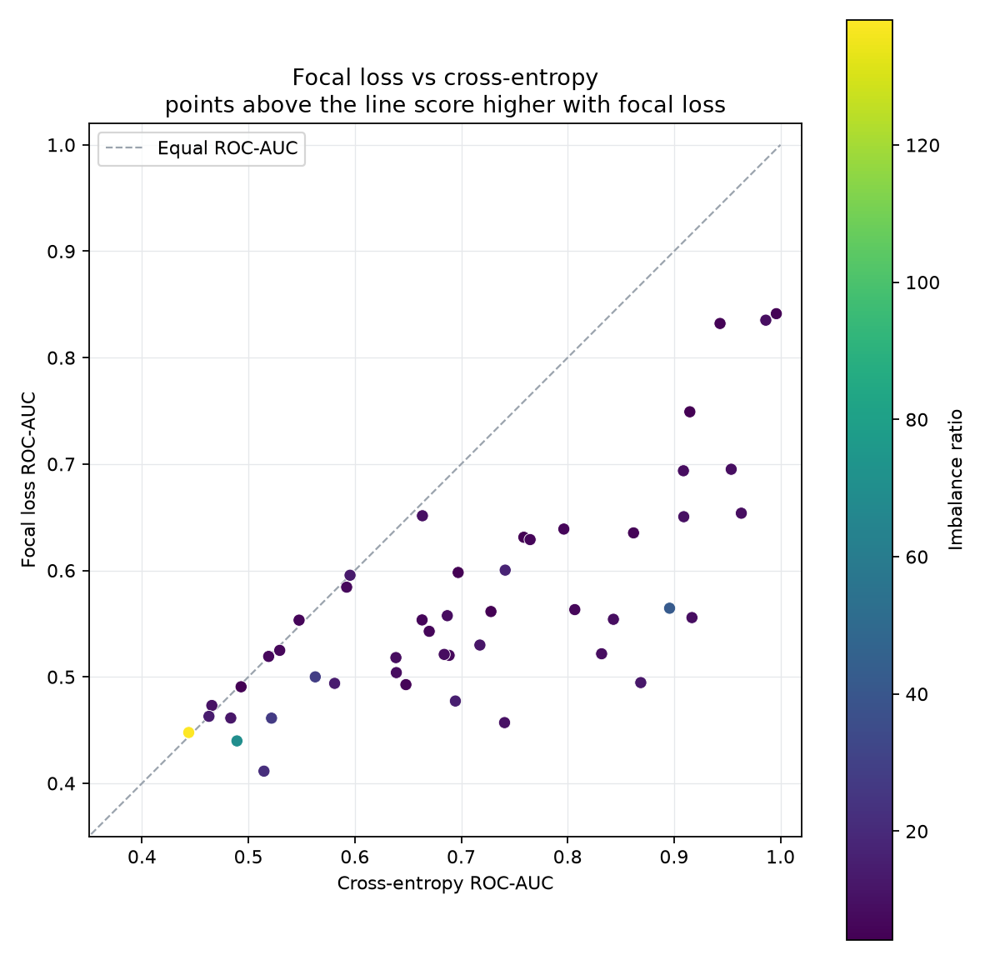
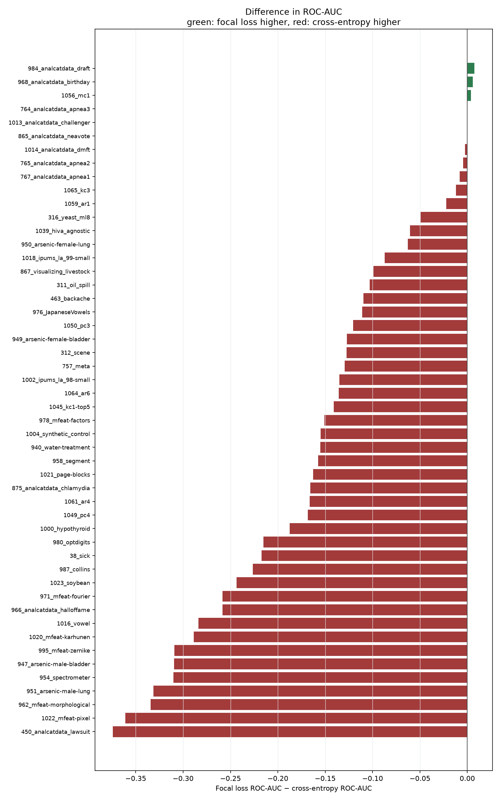

# Class imbalance in simple linear models

Course project for the machine learning course at Universidade do Porto. A logistic regression classifier is trained from scratch on 50 tabular datasets, once with binary cross-entropy and once with focal loss. Both runs use the same preprocessing, the same optimizer, and the same 5-fold stratified cross-validation, so the only thing that changes is the loss.

## Objectives

1. Build a baseline logistic regression trained with unweighted binary cross-entropy, optimized by gradient descent.
2. Replace that loss with focal loss ([Lin et al., 2017](https://arxiv.org/abs/1708.02002)), including class weights derived from how often each class appears.
3. Compare the two on metrics that stay informative when one class is rare: ROC-AUC, PR-AUC, F1, and recall.
4. See whether a loss designed for deep detectors still helps when the model can only learn a straight decision boundary.

## What is the point

Accuracy is a poor score when one class dominates. A model can look strong by always predicting the majority class and still miss every rare case. The question here is narrower than "how do we fix imbalance": if the classifier is deliberately kept linear, does changing the loss from cross-entropy to focal loss recover the minority class?

Focal loss was built for RetinaNet ([Lin et al., 2017](https://arxiv.org/abs/1708.02002)), where easy background pixels swamp the gradient. The modulating term (1 − p_t)^γ down-weights examples the model is already sure about, and α_t reweights the two classes. With γ = 0 the loss collapses back to cross-entropy. This project sets γ = 2 and asks whether that focus still helps once the model is a logistic regression over tabular features, not a convolutional network.

## What was used

**Model.** Logistic regression with a numerically stable sigmoid, σ(z) = ½ (tanh(z/2) + 1). An intercept column is added. Weights are updated by full-batch gradient descent (`autograd`), learning rate 0.01, at most 500 iterations, stop when the loss change falls below 10⁻⁴. An L2 penalty with C = 0.01 is applied to every weight except the intercept.

**Losses.**

- Binary cross-entropy, unweighted, with probabilities clipped away from 0 and 1.
- Focal loss with γ = 2. The minority class receives the larger α, proportional to the frequency of the other class.

**Data.** Fifty binary tabular CSV files in `datasets/`. The imbalance ratio (majority count divided by minority count) runs from 4.14 to 138.21, with a median of 8.92. Missing targets are dropped. Numeric columns are parsed as numbers; other columns are coded as categories. Remaining gaps are filled with the training-column median, then features are standardized inside each fold.

**Evaluation.** `StratifiedKFold`, 5 folds, shuffle, `random_state=42`. The decision threshold for precision, recall, F1, and specificity is 0.5. ROC-AUC and PR-AUC use the predicted probabilities. Reported numbers are the mean across folds. The same protocol is used for both losses.

**Libraries.** Python 3.11. Pinned versions are in `requirements.txt`: NumPy, pandas, scikit-learn, autograd, tqdm, matplotlib, and ipykernel.

```bash
python3.11 -m venv .venv
source .venv/bin/activate
pip install -r requirements.txt
python -m mla
```

`python -m mla` reruns both studies and rewrites the tables and figures in `output/`. In a notebook, choose the interpreter at `.venv/bin/python`.

## Files

| Path | What is in it |
|---|---|
| `mla/` | The study. `linear_models.py` is the classifier, `metrics.py` the losses, `data.py` loading and target names, `evaluate.py` the 5-fold loop, `plots.py` the figures. |
| `cross_entropy.ipynb` | Runs `run_cross_entropy` and prints the baseline table. |
| `focal_loss.ipynb` | Runs `run_focal_loss`, prints the focal-loss table, and keeps the written comparison. |
| `main.ipynb` | A short smoke test: linear regression on synthetic data, then logistic regression on three files. Not the study. |
| `datasets/` | The 50 source CSV files only. |
| `output/cross_entropy_results.csv` | One row per dataset for cross-entropy: size, imbalance ratio, and the mean and standard deviation of each metric. |
| `output/focal_loss_results.csv` | The same table for focal loss, plus γ and the two α weights. |
| `output/*.png` | ROC-AUC comparison figures described below. |
| `requirements.txt` | Package pins for `.venv`. |
| `PL3_G2.pdf` | Written project description. |

## Graphs

All three figures use the cross-validated ROC-AUC means from `output/cross_entropy_results.csv` and `output/focal_loss_results.csv`. They compare scores. They are not ROC curves.

### ROC-AUC by dataset



Each dataset has two bars. Blue is cross-entropy, orange is focal loss. The whiskers are the standard deviation across the five folds. Datasets are ordered by imbalance ratio, with the most skewed sets at the top. The dashed line is 0.5, a ranking no better than chance.

Cross-entropy is the longer bar on almost every row, including the sets at the top where the minority class is rarest. Focal loss sits near 0.5 on many of those sets, so the predicted probabilities are barely ordered. The fold whiskers are often wide, especially for focal loss: 500 steps at this learning rate do not settle to the same score on every split.

### Focal loss against cross-entropy



One point per dataset. The dashed line is equal ROC-AUC. A point above the line would mean focal loss ranked the classes better. Color is the imbalance ratio.

The cloud sits below the line. The yellow points, the most imbalanced datasets, are not the ones that cross above it. High imbalance does not mark the sets where focal loss wins. The points farthest below the line are datasets where cross-entropy already had a high ROC-AUC, often above 0.85, and focal loss pulled that score down toward 0.5.

### Difference in ROC-AUC



Each bar is focal loss minus cross-entropy. Green means focal loss is higher. Red means cross-entropy is higher.

Focal loss is higher on 4 datasets, cross-entropy on 44, and the scores match on 2. The green bars are tiny, at most +0.0075 (`analcatdata_draft`). The red bars reach −0.37. The largest drops are `analcatdata_lawsuit` (0.8687 to 0.4946), `mfeat-pixel` (0.9168 to 0.5557), and `mfeat-morphological` (0.6417 to 0.3074). Averaged over all 50 datasets the difference is −0.1485.

Splitting the collection does not change the story. On the 17 datasets with imbalance ratio at least 10, mean ROC-AUC falls from 0.6115 to 0.4810. On the 33 milder datasets it falls from 0.7541 to 0.5964.

## Final outlook

Focal loss did not improve the linear baseline. Mean scores across the 50 datasets:

| Metric | Cross-entropy | Focal loss |
|---|---:|---:|
| ROC-AUC | 0.7056 | 0.5572 |
| PR-AUC | 0.5712 | 0.4403 |
| F1 | 0.5191 | 0.4234 |
| Precision | 0.4770 | 0.3754 |
| Recall | 0.6530 | 0.6739 |
| Specificity | 0.6532 | 0.4239 |

Recall rises a little. Precision, specificity, F1, PR-AUC, and ROC-AUC all fall. The model becomes somewhat more willing to call the minority class, and much worse at ranking and at rejecting the majority class.

That pattern fits the model, not a broken implementation.

A logistic regression can only cut the feature space with one hyperplane. Focal loss reweights the gradient. It does not give the model a curved boundary. Where the classes overlap, or where a good separation is already linear, changing the loss cannot add capacity, and it can shove a working boundary toward the majority class.

The factor (1 − p)^γ also shrinks gradients on examples the model already classifies confidently. With only 500 steps and a step size of 0.01, those smaller updates often stall before the weights reach the cross-entropy solution. Several focal-loss ROC-AUC scores sit near 0.5, which is what an unfinished or collapsed ranking looks like.

α and γ are applied together. The rare class is both up-weighted and further emphasized whenever the model is unsure. On these tables the combination overshoots: specificity drops by about 0.23 while recall gains about 0.02. The extra minority predictions are mostly false positives.

The practical conclusion is that focal loss, as used in RetinaNet, is not a drop-in repair for class imbalance in a linear model. On this collection the unweighted cross-entropy logistic regression is the stronger of the two, and the gap shows up on both mildly and severely imbalanced datasets.


## Project created with @kasiakk216
